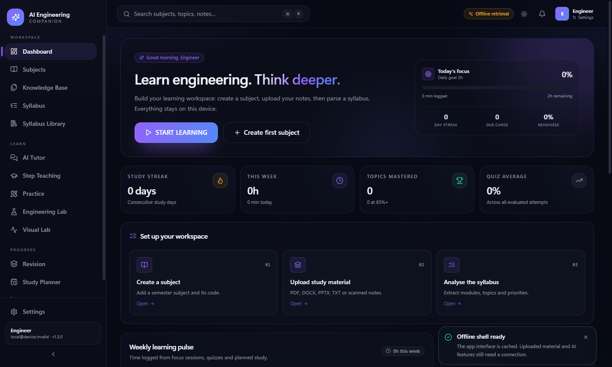
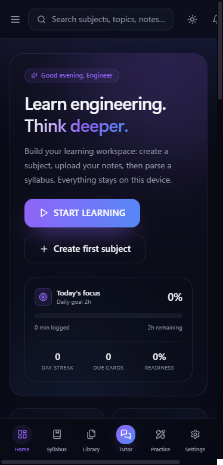

# AI Engineering Companion

**Learn engineering deeply. Keep the sources visible.**

[](https://github.com/jibinpj-3665/ai-engineering-companion/actions/workflows/ci.yml)
[](https://github.com/jibinpj-3665/ai-engineering-companion/releases)
[](LICENSE)
[](SECURITY.md)

An engineering study workspace for Windows desktop, browser, and installable PWA. Upload notes, map a syllabus, learn through a ten-phase teaching workflow, practise with source-grounded quizzes, revise with spaced repetition, and prepare for university exams. Run it locally on your own machine or self-host it with PostgreSQL and per-account isolation.

<p align="center">
  
  
</p>

> **v1.3.0 release status:** the Windows desktop package and packaged backend are smoke-tested. The installer is unsigned. Docker/PostgreSQL/cloud deployment, OCR, and SMTP remain unverified. A final all-green live Gemini verification is blocked by the free-tier daily quota. See the [v1.3.0 release notes](docs/releases/v1.3.0.md) and [publication checklist](docs/releases/v1.3.0-checklist.md).

## Contents

- [Why this exists](#why-this-exists)
- [Features](#features)
- [Quick start](#quick-start)
- [AI provider configuration](#ai-provider-configuration)
- [Privacy and data](#privacy-and-data)
- [Testing](#testing)
- [Release verification](#release-verification)
- [Architecture](#architecture)
- [Tech stack](#tech-stack)
- [Project layout](#project-layout)
- [Limitations](#limitations)
- [Contributing](#contributing)
- [License](#license)

---

## Why this exists

Most study apps are chat windows with a login screen. This one is built around how engineering is actually examined: syllabus coverage, derivations, numericals, diagrams, viva questions, lab work, and repeatable practice. It is explicit about what it knows:

- **No invented citations.** Answers cite indexed document pages and can be checked against the original.
- **No fake completion.** Topics are only marked learned or mastered after passing a mastery quiz.
- **No silent AI dependency.** Offline retrieval works without a key and is labelled as material-grounded scaffolding.
- **No hidden provider failures.** Streaming errors are reported; the app does not pretend a remote model answered.

## Features

### Desktop, web, and mobile
- Local-first Windows desktop app with Electron and a packaged FastAPI backend.
- Self-hosted web app with email/password accounts, PostgreSQL, secure cookies, and per-account data isolation.
- Installable PWA for Android, iPhone, and desktop browsers, with an offline application shell.
- Responsive layout with mobile bottom navigation.
- Dark/light theme, five accent colours, command palette (`Ctrl+K`), and notifications.

### Knowledge workspace
- Subjects with semester, department, and colour coding.
- PDF, DOCX, PPTX, TXT, Markdown, and image uploads (PNG, JPG, TIFF, WebP).
- Page-aware extraction with heading and table detection, plus optional OCR when Tesseract is available.
- Chunked local embeddings and full-text retrieval across your material.
- Upload progress, staged extraction/indexing status, retries, crash recovery, preview, search, reprocessing, and download of originals.
- Per-account ZIP backup and restore with credentials excluded.

### Syllabus intelligence
- AI-assisted or heuristic syllabus parsing.
- Module, marks, and description extraction.
- Priority scoring with a visible reason for every topic.
- Coverage mapping: which syllabus topics are supported by your material and which are missing.
- Manual topic add/edit and status tracking.
- Syllabus Library folder import with SHA-256 duplicate detection, versioned re-imports, and a downloadable manifest.
- Structured course metadata, modules, CO/Bloom outcomes, CO-PO mappings, lecture-hour schedules, page-linked source access, and semester-wise progress.
- Local desktop folder picker; server imports require the path to be under `AEC_IMPORT_ROOTS`. Originals are never modified.
- Unindex, re-parse, and rebuild preserve the stored copy and your topic progress while excluding superseded material from search and RAG.

### Ten-phase step teaching
1. Real-world context
2. Intuition and simplification
3. Formal definition
4. Derivation and mathematics
5. Diagram / visual explanation
6. Worked example
7. Engineering application and design trade-offs
8. Exam strategy
9. Common mistakes and memory anchors
10. Mastery check

Each phase is generated from your indexed material, can be regenerated, and reports its citations. Opening phases tracks progress; only a mastery quiz at 70%+ marks a topic learned, and 85%+ marks it mastered.

### AI Tutor
- Five personalities: study buddy, professor, strict examiner, engineering mentor, beginner-friendly teacher.
- Real token streaming with a stop button and explicit provider errors.
- Teaching modes: ask, explain, Socratic, derive, worked example, simplify, quiz, debug coach, and examiner.
- Retrieval-augmented answers with per-message citations.
- Structured answer grading that does **not** silently change mastery.
- Conversation history and subject-scoped tutoring.
- Speech input where the browser exposes speech recognition, plus text-to-speech.
- OpenAI, Google Gemini, Groq, local Ollama/LM Studio, custom OpenAI-compatible endpoints, and offline retrieval.

### Practice and mock exams
- Seven assessment modes: quick quiz, topic test, module exam, university model exam, timed exam, viva, and mastery check.
- Question types: MCQ, true/false, fill-in-the-blank, short answer, long answer, derivation, numerical, programming, and viva.
- 2/5/10-mark model exam distribution with a 90-minute window.
- AI or keyword-based evaluation with explanations, improvement notes, mistake analysis, and saved questions.
- Attempt history with per-question feedback.

### Spaced revision
- SM-2-inspired scheduling with ease, interval, repetitions, and lapses.
- Due queue, reveal-and-grade workflow, and a full card library.
- Flashcard generation from notes and quiz mistakes.

### Planning and analytics
- Exam calendar with countdowns and weightings.
- Exam-aware study plan generation by daily minutes and horizon.
- Ranked topic queue based on weight, mastery gap, and exam proximity.
- Focus timer (25/50/90 minutes) that logs real study time.
- Weekly study-time chart, subject completion, quiz averages, retention, streaks, and an explainable exam-readiness score.

### Virtual labs and visual experiments
Eight guided experiments: RC step response, sampling and aliasing, FIR low-pass design, Verilog modulo-10 counter, Arduino PWM, CMOS inverter, FFT spectrum analysis, and series RLC resonance. Labs include a CodeMirror editor, saved artifacts, copy/download, and optional LTspice guidance.

Interactive visual lab experiments cover sampling and aliasing, RC charging, RLC resonance, diode operating point, logic gates, CMOS transfer curves, harmonic synthesis, and a DFT spectrum. All are educational simulations, not hardware-verified measurements.

## Quick start

### Option A - Install the Windows app

Download **AI-Engineering-Companion-Setup.exe** from [Releases](https://github.com/jibinpj-3665/ai-engineering-companion/releases/latest), or build it locally with `npm run dist`. The installer is unsigned, so Windows SmartScreen may ask you to confirm the publisher. Verify downloads against the checksums in the [v1.3.0 release notes](docs/releases/v1.3.0.md).

### Option B - Run from source

Requirements: Windows 10/11, Node.js 22+, Python 3.11.

```powershell
npm install
npm --prefix frontend install
py -3.11 -m venv backend\.venv
backend\.venv\Scripts\python.exe -m pip install -r backend\requirements.txt
npm run desktop:dev
```

Backend only: `npm run dev:backend` (http://127.0.0.1:8765).  
Frontend only: `npm run dev:frontend` (http://localhost:5173).

### Option C - Build the Windows installer

```powershell
npm run dist
```

This builds the React app and PWA, bundles FastAPI with PyInstaller, and packages both with electron-builder into `release\AI-Engineering-Companion-Setup.exe`.

### Option D - Run the web app with Docker

> **Preview path:** the Docker/PostgreSQL stack is provided but was not runtime-verified for v1.3.0. Run the container and PostgreSQL CI checks before exposing it to users.

With Docker and Docker Compose installed:

```powershell
Copy-Item .env.example .env
# Set POSTGRES_PASSWORD, AEC_PUBLIC_URL, and optional AI/SMTP keys
docker compose up -d --build
```

Open <http://localhost:8080> for local testing. Put an HTTPS reverse proxy in front before exposing it. Compose runs PostgreSQL, enables required accounts, and binds the app to loopback by default.

See [docs/WEB_DEPLOYMENT.md](docs/WEB_DEPLOYMENT.md) for Caddy/Nginx, first-account setup, SMTP, server-side AI keys, backups, upgrades, security, and troubleshooting.

### Remote desktop mode

The desktop shell can load a self-hosted instance instead of spawning a local backend:

```powershell
$env:AEC_REMOTE_URL = "https://study.example.com"
npm start
```

Remote URLs must use HTTPS unless they point at localhost. The local backend is not started in this mode.

## AI provider configuration

Offline retrieval is the default and needs no account or key. To enable a language model, open **Settings → AI provider**.

| Provider | Default base URL | Notes |
| --- | --- | --- |
| Offline | - | Local retrieval and structured scaffolds. No network calls. |
| OpenAI | `https://api.openai.com/v1` | Enter a key and model such as `gpt-4o-mini`. |
| Google Gemini | `https://generativelanguage.googleapis.com/v1beta` | Official `google-genai` SDK, native async streaming, exact source labels. |
| Groq | `https://api.groq.com/openai/v1` | Fast OpenAI-compatible inference. |
| Local | `http://127.0.0.1:11434/v1` | Ollama or LM Studio. No key required. |
| Custom | provider-specific | Any OpenAI-compatible gateway. |

Desktop and single-user servers can store an encrypted per-account key. Shared servers should use `AEC_ENV_KEYS_ONLY=1` with provider keys supplied through environment variables; the browser never receives those keys. Use **Save & test** and **Models** to verify connectivity.

Gemini uses Google's official `google-genai` SDK rather than a hand-written HTTP client. The key is resolved from `AEC_GEMINI_API_KEY`, `GEMINI_API_KEY`, or `GOOGLE_API_KEY`, then from the encrypted account key when environment-only mode is off. Optional overrides are `AEC_GEMINI_BASE_URL` and `AEC_GEMINI_MODEL`. HTTP 401/403, 404, 429 quota/rate-limit, timeout, and temporary 5xx failures are translated into actionable messages without exposing keys.

Grounded answers use exact `[S1]` labels from retrieved chunks; each saved source preserves its label, document, page, heading, score, and whether the answer cited it. An answer without a valid source label is explicitly flagged rather than presented as verified.

Remote embeddings can be enabled separately. In offline mode, local feature-hashing embeddings keep retrieval functional. Retrieval data is stored in the relational `DocumentChunk` table; this repository does not use ChromaDB and does not ship a Chroma index.

## Privacy and data

Desktop data lives in `%LOCALAPPDATA%\AIEngineeringCompanion`:

- Database: `aec.db` (SQLite, WAL mode)
- Uploads: `uploads\`
- Logs: `logs\`
- Backups: `backups\`
- `secret.key` for encrypted provider keys

Override locations with `AIEC_DATA_DIR`, `AEC_PORT`, `AEC_STATIC_DIR`, or `AEC_MAX_UPLOAD_MB`. Windows uninstall does not delete this folder. No telemetry is sent anywhere.

When an AI provider is configured, the prompt and retrieved context needed to answer are sent to that provider. The app does not send your entire workspace. Server deployments store data in PostgreSQL plus the Docker data volume; see the deployment guide.

## Testing

```powershell
npm test                 # backend pytest + frontend vitest
npm run test:backend     # 47 backend tests; live Gemini variants skip without a key
npm run test:frontend    # 10 frontend tests
npm run typecheck        # TypeScript strict check
```

To run the opt-in live Gemini test:

```powershell
$env:AEC_GEMINI_API_KEY = "..."
backend\.venv\Scripts\python.exe -m pytest backend -m live -q
```

Backend tests cover the official Gemini SDK adapter, async streaming, quota/auth error mapping, grouped citation annotation, PDF/DOCX/TXT ingestion, syllabus import/duplicate/reparse/unindex, import allow-list security, every protected API route without a session, invalid and expired sessions, tenant isolation including conversations and downloads, CSRF blocking, backup/restore, streaming SSE, and document validation. CI also runs the backend suite against PostgreSQL 16 in a separate job.

## Release verification

v1.3.0 was verified with:

- 47 passing backend tests and 10 passing frontend tests.
- TypeScript strict typecheck and a production PWA build.
- 23/23 account-mode HTTP checks against both the source backend and the packaged backend from fresh temporary data.
- A packaged Electron smoke test, no leftover backend process, and a captured dashboard screenshot.
- A migration test that restored 119 chunk subject IDs, plus a subject/document/conversation backup-restore round-trip.
- Clean `pip-audit`, clean `pip check`, and zero production npm vulnerabilities in the root tree.

The remaining frontend production advisories are four low-severity KaTeX-toolchain findings. Detailed verification evidence, artifact checksums, and publication caveats are in the [v1.3.0 release notes](docs/releases/v1.3.0.md).

## Architecture

```text
Electron main process (optional)
  └─ spawns packaged FastAPI backend on a free localhost port
        ├─ PostgreSQL (web) or SQLite (desktop), uploads, logs
        ├─ /api/* JSON + SSE
        └─ serves the built React SPA and PWA assets

Browser / installed PWA
  └─ same-origin React app with session cookies
```

```text
React + TypeScript + Vite + Tailwind
  └─ dashboard, subjects, knowledge base, syllabus, tutor,
     syllabus library, teaching, practice, revision, planner, analytics,
     labs, visual lab, settings, auth

FastAPI + SQLAlchemy 2
  └─ routers, tenant-scoped sessions, document pipeline,
     syllabus parser/library, provider adapters, retrieval, backup, auth
```

More detail: [docs/ARCHITECTURE.md](docs/ARCHITECTURE.md)

- User workflows: [docs/USER_GUIDE.md](docs/USER_GUIDE.md)
- Web deployment: [docs/WEB_DEPLOYMENT.md](docs/WEB_DEPLOYMENT.md)

## Tech stack

- **Frontend:** React 18, TypeScript, Vite 6, Tailwind CSS, Framer Motion, Recharts, KaTeX, react-markdown, CodeMirror, vite-plugin-pwa.
- **Backend:** FastAPI, SQLAlchemy 2, SQLite/PostgreSQL, Pydantic 2, PyMuPDF, python-docx, python-pptx, Pillow, pytesseract, cryptography, psycopg.
- **AI:** Official Google Gen AI SDK for Gemini, OpenAI-compatible adapters, SSE streaming, local feature-hashing embeddings, relational RAG (no ChromaDB).
- **Desktop:** Electron 45, electron-builder, NSIS.
- **Testing:** pytest, Vitest, Testing Library, GitHub Actions PostgreSQL service.

## Project layout

```text
backend/            FastAPI app, services, routers, tests
frontend/           React PWA and Vitest tests
desktop/            Electron main process and preload
assets/             Icon and splash screen
scripts/            Backend build, icon generation, screenshots
docs/               Architecture, user guide, deployment, release notes
release/            Built installer and unpacked app
```

## Limitations

- This is a study aid, not a replacement for lectures, textbooks, laboratory supervision, or your university's academic-integrity rules.
- AI-generated content can be wrong. Verify derivations, numerical results, and citations against source material.
- Virtual labs and visual simulations are educational models, not hardware measurements or sign-off SPICE decks.
- OCR requires a separate Tesseract installation on desktop. The Dockerfile installs Tesseract, but OCR was not verified in this release.
- Speech recognition depends on browser support and is not guaranteed in Electron.
- The web deployment is single-replica and stores uploads on a local volume; S3-compatible object storage and horizontal scaling are not implemented.
- The Docker/PostgreSQL/cloud deployment path was not runtime-verified for v1.3.0.
- There is no admin role or email verification. Close registration after onboarding unless open sign-up is intended.
- The Windows installer is unsigned; code signing requires your own certificate.
- SMTP password-reset delivery and real cloud deployment were not verified; both depend on external credentials.
- Live Gemini calls were made during release verification. Connection, a cited engineering answer, a numerical answer, and streaming each succeeded in separate runs; the free-tier daily quota was then exhausted, so a final all-green live rerun remains pending. Grouped-citation parsing and the configurable 4096-token output limit are covered by mocked tests. No API key is bundled, and the opt-in live tests skip without one.
- Retrieval uses relational `DocumentChunk` records. No ChromaDB implementation or index is present in this repository.
- Folder import is synchronous, so very large folders can take time; a background import queue is not implemented.
- The reference Sahrdaya corpus used during validation preserves two source-level imperfections: VLSI labels its fourth module `Module VI`, and one VLSI topic starts with the printed fragment `iffusion`. Page references and original labels are retained for verification.

## Contributing

Development setup, quality gates, and security expectations are documented in [CONTRIBUTING.md](CONTRIBUTING.md). Report vulnerabilities privately according to [SECURITY.md](SECURITY.md).

## License

MIT © 2026 jibinpj-3665. See [LICENSE](LICENSE).
